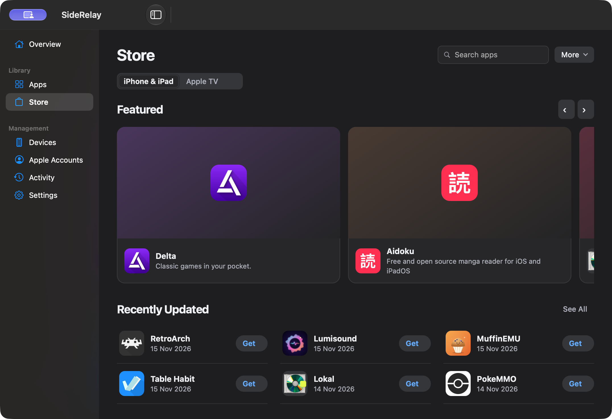
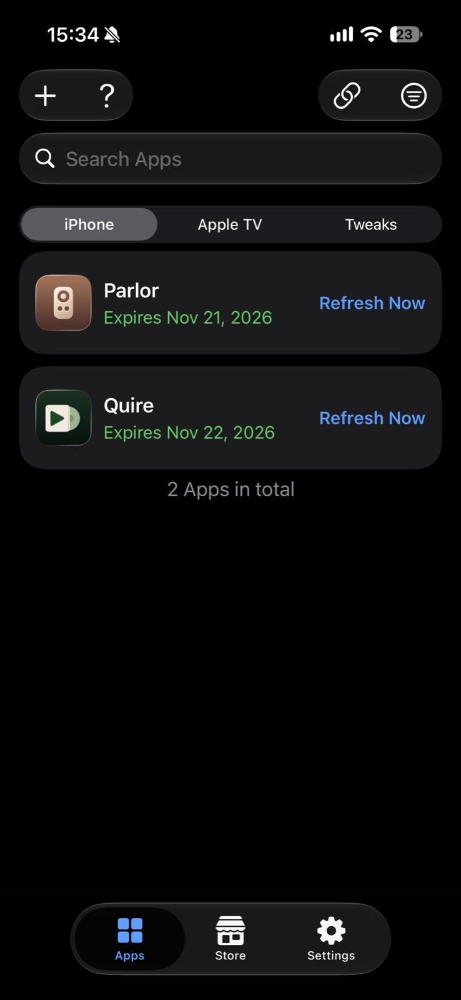
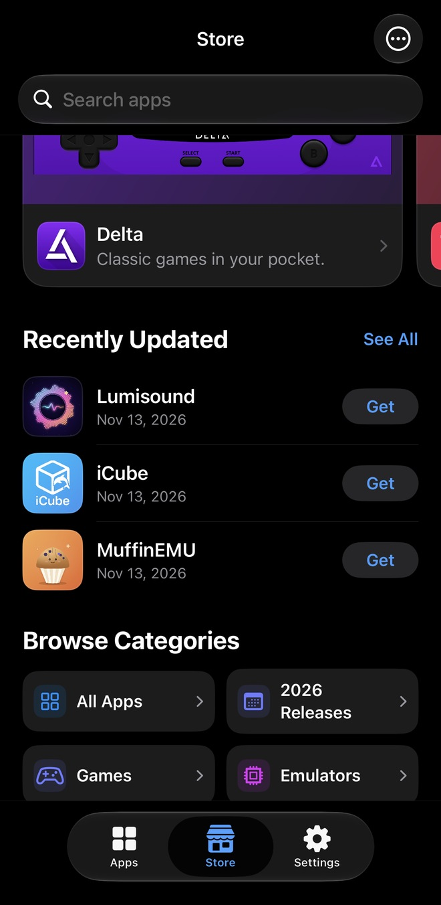
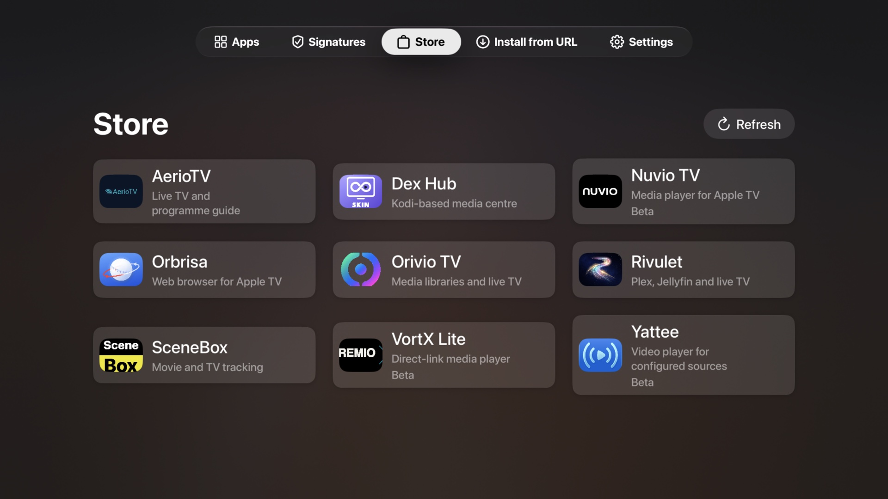
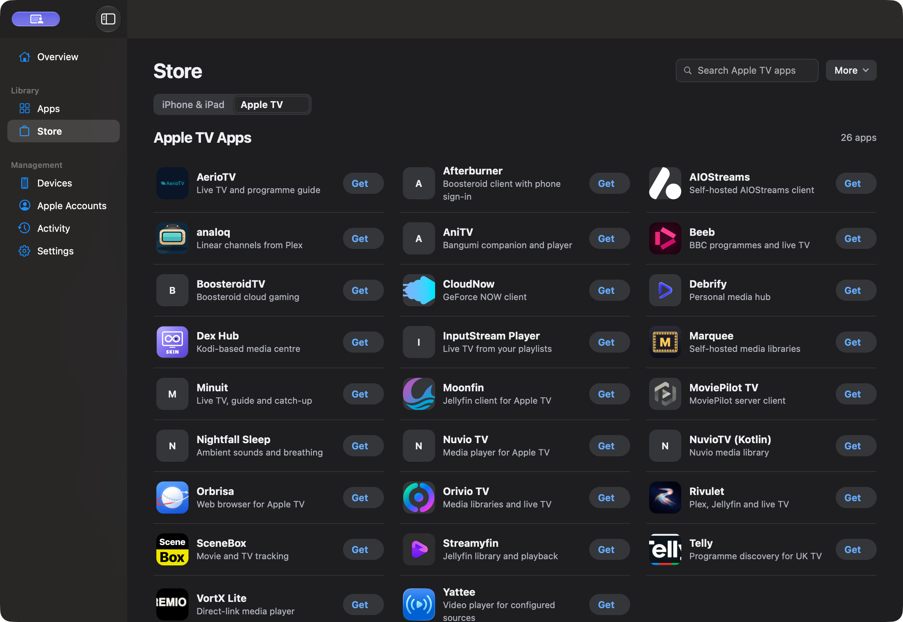

  

<h1 align="center">SideRelay</h1>

<strong>Keep your iPhone apps signed while you’re away.</strong>

  Leave SideRelay running on your Mac and it automatically renews your sideloaded iPhone apps over Tailscale, even when you’re on a different Wi-Fi network. Manage iPhone and Apple TV apps from the same Mac, with a Store on both devices.

  

  DMG · Apple silicon · macOS 15+ · <a href="#getting-started">Setup</a> · <a href="#compare-sideloading-tools">Compare</a> · <a href="CHANGELOG.md">Changelog</a>

  

## What you can do

| | |
| :--- | :--- |
| **Refresh your apps when you’re away** | Your Mac checks signatures and renews apps as they near expiry. Connect the Mac and iPhone to the same Tailscale network and keep the iPhone on reachable Wi-Fi. USB and local Wi-Fi also work. Apple TV installs and refreshes over the Mac’s local network. |
| **Find apps and run them on iPhone or Apple TV** | Browse the built-in Store on Mac, iOS, and tvOS. Install IPAs as separate apps or run compatible apps inside **LiveContainer** on iPhone and **TVContainer**, its tvOS port, on Apple TV. |
| **Turn finished IPAs into one-click updates** | Choose a drop folder under **Settings → App Updates**. New apps appear in **IPA Inbox**, and newer builds for installed apps surface an **Update** button. Use the same folder for builds from Xcode, CI, or another Mac. |
| **Keep signing accounts organized** | Connect multiple Apple Accounts on the same Mac. Choose the account for each new install, see which apps use each certificate, and renew existing apps with their original account. |

## On every screen

### iPhone

  
  

Open **Apps** to check expiry dates, refresh a signature, or launch a LiveContainer app. Use **Apps → Apple TV** to browse apps on a linked Apple TV, send an IPA from Files, and follow its installation from your iPhone.

### Apple TV

  

On your Mac, open **Store → Apple TV** to browse and search the [tvOS catalogue](Interface/StoreTV.json). On Apple TV, pick an app with the Siri Remote, open **Signatures** to check expiry, or run compatible tvOS apps in **TVContainer**.

<strong>More Mac features and screenshots</strong>

 

- **Apps Library.** Keep older builds, install multiple IPAs as a batch, and restore a saved build when you need it.
- **IPA Workshop.** Inspect entitlements and provisioning, export signed builds, or customize a compatible IPA before signing.
- **Signing diagnostics.** See Apple’s App ID quota, review unused IDs, and check certificates or installation logs from **Activity**.
- **Store sources.** Browse the [bundled iPhone catalogue](Interface/Store2026.json), add [AltStore-compatible feeds](Interface/StoreSources.json), and find screenshots, release notes, and version history supplied by publishers.
- **Home Screen shortcuts.** Tap **Add to Home Screen** next to a LiveContainer app, then choose **Share → Add to Home Screen → Add** in Safari. The icon opens that app in one tap.

## Getting started

1. **Install SideRelay on Mac.** Open the DMG and drag **SideRelay.app** to **Applications**. The build uses an ad hoc signature and ships without Apple notarization. See [Apple’s first-launch instructions](https://support.apple.com/en-us/102445) if macOS asks you to approve it.
2. **Connect your device.** Plug in your iPhone and follow the prompts for **Trust** and **Developer Mode**. For Apple TV, pair it in Xcode, then open **Devices → Add Apple TV** in SideRelay.
3. **Sign and install.** Connect an Apple Account and drop a compatible IPA into **Apps**. A free Apple Account works within Apple’s Personal Team limits. Choose **LiveContainer** during iPhone setup to add the optional companion.
4. **Keep signatures current.** Leave SideRelay running and enable **Auto-Refresh** for the apps you want it to renew. Test the connection with **Refresh Now**. For remote iPhone refresh, keep Tailscale on both devices and the iPhone’s Apple pairing service reachable over Wi-Fi.

The [Apple TV companion guide](docs/APPLE-TV.md) covers the current advanced setup for the tvOS Store, TVContainer, and **Apps → Apple TV** on iPhone. The [Mac distribution guide](docs/MAC-DISTRIBUTION.md) covers building from source.

## Compare sideloading tools

✅ Documented support · ❌ No documented support in that product. Where a feature requires a specific platform, companion, or subscription, the table indicates it.

| Tool | Background refresh | Tailscale workflow | Apple TV installs | App catalogues | Watched IPA folder |
| :--- | :--- | :--- | :--- | :--- | :--- |
| **SideRelay** | ✅ Mac scheduler | ✅ iPhone over Wi-Fi | ✅ Network install and refresh | ✅ Mac, iPhone, Apple TV | ✅ |
| [AltStore Classic](https://faq.altstore.io/altstore-classic/altserver) | ✅ AltServer | ❌ | ❌ | ✅ iPhone | ❌ |
| [SideStore](https://docs.sidestore.io/docs/installation/prerequisites) | ✅ iPhone + LocalDevVPN | ❌ | ❌ | ✅ iPhone | ❌ |
| [Sideloadly](https://sideloadly.io/changelog) | ✅ Desktop daemon | ❌ | ✅ tvOS refresh via Patreon | ❌ | ❌ |
| [Impactor](https://github.com/claration/Impactor/releases) | ✅ USB or local Wi-Fi on supported platforms | ❌ | ❌ | ❌ | ❌ |
| [iLoader](https://github.com/nab138/iloader) | ❌ Sets up SideStore | ❌ | ❌ | ❌ | ❌ |
| [Feather](https://github.com/claration/feather) | ❌ | ❌ | ❌ | ✅ iPhone | ❌ |
| [Apparition](https://github.com/illixion/Apparition#what-it-does) | ✅ On device | ✅ Desktop companion | ✅ | ✅ | ❌ |
| [SideTVstore](https://github.com/hubzzzgr/SideStore-tvOS) | ❌ Manual refresh documented | ❌ | ✅ From iPhone on local Wi-Fi | ✅ | ❌ |

AltStore Classic also offers [Remote AltServers](https://faq.altstore.io/altstore-classic/remote-altservers) over Wi-Fi with LocalDevVPN.

<strong>Frequently asked questions</strong>

**Can my iPhone renew signatures on cellular alone?** SideRelay’s remote renewal requires Wi-Fi and a reachable Apple pairing service. Tailscale connectivity alone on cellular didn’t make that service reachable in testing.

**Do I need a paid Apple Developer membership?** A free Apple Account works. Apple’s Personal Team limits on app slots, App IDs, certificates, and provisioning still apply. The iPhone companion occupies one separate app slot. [Apple developer account overview](https://developer.apple.com/help/account/basics/about-your-developer-account)

**Which apps can I run inside a container?** Compatibility depends on the IPA, its extensions, and its runtime requirements. Install as a separate app when you need the standard system integration or the app requires features the container can’t provide.

## License

SideRelay’s original code is available under [Zero-Clause BSD (0BSD)](LICENSE). The iPhone and Apple TV companion builds include AGPL-3.0 code from [LiveContainer](https://github.com/LiveContainer/LiveContainer) and [TVContainer](https://github.com/hubzzzgr/TVContainer/blob/ffa3d5aeef32cdc9c8ee1de3d898307c5166eac5/LICENSE). The [companion source and build scripts](Compagnon/) are included here.

The Mac’s signing engine uses JAS, whose author requires written permission for commercial use of JAS-specific code, and isideload under MIT. Store sources and apps are governed by their publishers’ terms. [JAS license terms](https://github.com/jkcoxson/jas/blob/cf709e4a5fb298a20cb595e0d5f1f263e4c82bef/README.md#license) · [isideload license](docs/licenses/isideload-MIT.txt)

## Credits

- The [LiveContainer contributors](https://github.com/LiveContainer/LiveContainer#credits) for the iPhone app container and its management UI.
- [hubzzzgr and the TVContainer contributors](https://github.com/hubzzzgr/TVContainer) for bringing LiveContainer to Apple TV.
- [Jackson Coxson](https://github.com/jkcoxson) for [JAS](https://github.com/jkcoxson/jas), [idevice](https://github.com/jkcoxson/idevice), and [idevice_pair](https://github.com/jkcoxson/idevice_pair).
- The [isideload contributors](https://github.com/nab138/isideload), [Tailscale](https://tailscale.com/), and the maintainers of the apps and sources in the Store.
