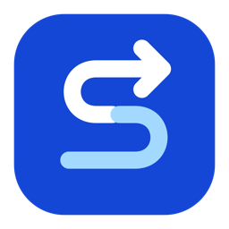
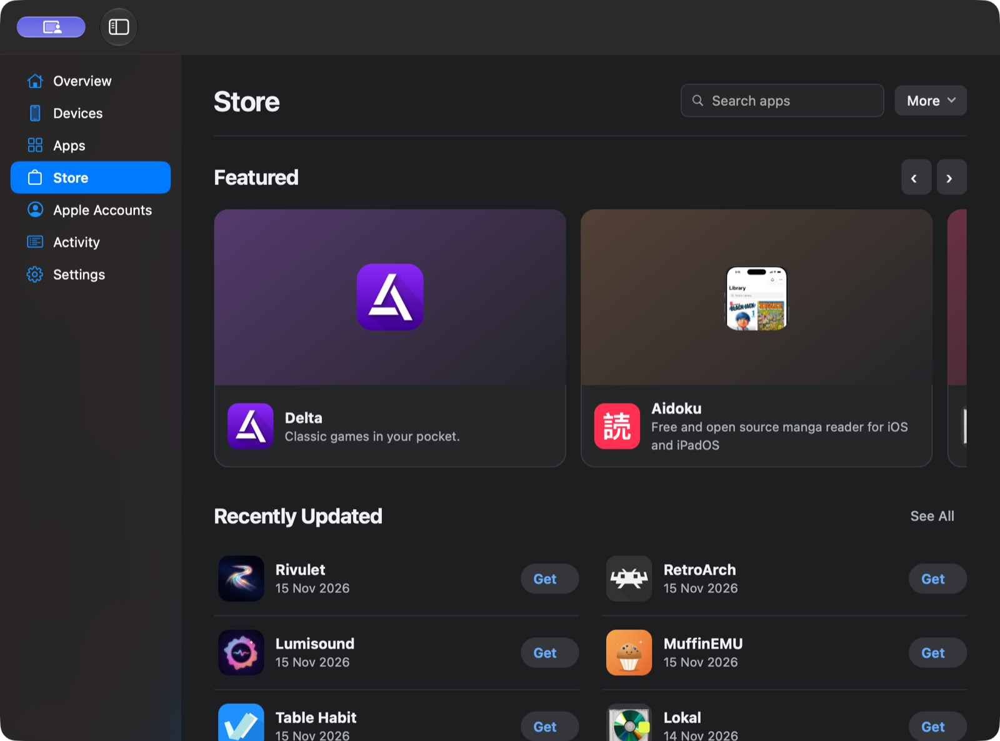

  

<h1 align="center">SideRelay</h1>

<strong>Discover, sign, install, and refresh apps from your Mac.</strong>

  <a href="https://github.com/arkemys-consulting/SideRelay/releases/latest"><strong>Download SideRelay for macOS</strong></a> 
  Apple silicon · macOS 15 or later

  <a href="#what-you-can-do">Features</a> · <a href="#compare-sideloading-tools">Compare</a> · <a href="#getting-started">Getting started</a> · <a href="CHANGELOG.md">Changelog</a> · <a href="#faq">FAQ</a> · <a href="#license">License</a>

  
  

<a href="docs/screenshots/ios.jpg">See the Apps view on iPhone</a>

## What you can do

### Refresh over USB, Wi-Fi, or Tailscale

Leave SideRelay running on your Mac and it checks for apps nearing expiry. It starts trying to refresh them when less than three days remain and uses USB when your paired iPhone is plugged in. With Tailscale on both devices, your iPhone can use a different Wi-Fi network from your Mac, as long as its Apple pairing service is reachable. Local network discovery via Bonjour is also available.

### Install and auto-refresh Apple TV apps

Pair your Apple TV in Xcode on the Mac, then choose **Devices → Add Apple TV** in SideRelay. Drop a tvOS IPA into **Apps**, select the Apple TV and your Apple Account, and leave **Store IPA for auto-refresh** enabled. A free Apple Account works within Apple’s Personal Team limits.

SideRelay re-signs the saved IPA before expiry and installs it in place over the local network. Keep the Mac running and the Apple TV reachable. You can also choose **Refresh Now** on the app’s card.

### Discover apps in the built-in Store

The Store on macOS and iOS starts with **51 preloaded source feeds** and a **bundled collection of 199 app listings**. Browse featured apps, categories, and recent releases, or search by name. Product pages show screenshots, release notes, version history, and compatibility when the publisher supplies them. You can add your own AltStore-compatible source, too.

On Mac, **Get** brings an IPA into your Library for installation review. On iPhone, **Get** opens the import confirmation for LiveContainer. [Default feeds](Interface/StoreSources.json) · [Bundled collection](Interface/Store2026.json)

### Choose how each IPA runs

Install an IPA as a **separate app** from the Mac, or import a compatible IPA into **LiveContainer** in the SideRelay iPhone companion. SideRelay installs the companion and can set up its signing certificate using the paired iPhone. Both types appear together in **Apps**, with a badge for LiveContainer imports.

### Keep one signing identity per Apple team

SideRelay keeps its certificate and private key in an encrypted archive on the Mac and reuses the identity when Apple still lists it as active. If you need to replace a certificate, SideRelay shows the affected apps it knows about before you confirm. It can then queue those apps for re-signing when their IPAs are available.

<strong>More features</strong>

- **IPA Library.** Drop one IPA or a batch, import an Xcode build, inspect contents, and keep previous versions. Sign a batch for export or sign and install it in order.
- **Local IPA updates.** Choose a folder in **Settings → App Updates** and drop finished `.ipa` files there. The default is `IPA-Inbox` next to the `donnees` folder, or `~/Library/Application Support/SideRelay/IPA-Inbox` for the standalone Mac bundle. SideRelay imports the files into **Library**. In **Apps**, **Update** appears when a compatible IPA has the same Bundle ID and a higher version or build. The update opens installation review for the existing device and account.
- **Installation checks.** Review provisioning profiles, device eligibility, expiration dates, and App IDs needed by an app and its extensions.
- **App ID management.** Open **Apple Accounts → … → Manage App IDs…** to check usage, expiry, and the quota Apple reports. Personal Teams can remove unused IDs after SideRelay checks its paired devices and Apple’s device lists, or enable automatic cleanup. Apple may count a removed ID until its original expiry.
- **IPA Workshop.** Rename an app, change its icon or bundle identifier, remove selected extensions, enable document sharing, or add compatible tweak components. Save settings as a preset.
- **Local signing.** Import a compatible `.p12` and provisioning profiles to sign locally. Use Xcode to install an already signed IPA on a supported paired device.
- **App management.** See signing expiry dates, request a refresh from iPhone, and back up or restore documents for apps that support file sharing.
- **LiveContainer controls.** Manage tweaks, create Home Screen shortcuts, and opt in to automatic LiveContainer updates.
- **Activity.** Follow installs and refreshes, review errors, and see the relevant recovery action when available.

## Compare sideloading tools

SideRelay fits a setup where you leave a Mac running and want one interface for signing, refreshes, and app discovery. You can install each IPA as a separate app or send it to the iPhone companion to run inside LiveContainer.

| Tool | Where you sign and install | How apps stay refreshed | App discovery |
| :--- | :--- | :--- | :--- |
| **SideRelay** | **Mac signs and installs separate apps or sends compatible IPAs to LiveContainer** | **Mac refreshes over USB, local Wi-Fi, or Tailscale across Wi-Fi networks** | **Store on Mac and iPhone: 51 preloaded feeds and 199 bundled listings** |
| [AltStore Classic](https://faq.altstore.io/altstore-classic/altserver) | iPhone app and AltServer on Mac or Windows | USB or local Wi-Fi with AltServer; [Remote AltServer](https://faq.altstore.io/altstore-classic/remote-altservers) works away from your computer with Wi-Fi and LocalDevVPN | iPhone catalog and [trusted sources](https://faq.altstore.io/altstore-classic/trusted-sources) |
| [SideStore](https://docs.sidestore.io/docs/faq) | On iPhone after initial setup from a computer | [On iPhone with Wi-Fi and LocalDevVPN](https://docs.sidestore.io/docs/installation/prerequisites); no computer needed for routine refreshes | [AltStore-compatible sources](https://docs.sidestore.io/docs/advanced/app-sources) on iPhone |
| [Sideloadly](https://sideloadly.io/faq) | Desktop installer for Mac and Windows | Desktop daemon refreshes over USB or the same local network | Bring your own IPA |
| [LiveContainer + SideStore](https://github.com/LiveContainer/livecontainer.github.io/blob/main/docs/installation/lc_sidestore.md) | LiveContainer runs compatible IPAs; the bundled SideStore signs and installs separate apps | Bundled SideStore refreshes on iPhone with Wi-Fi and LocalDevVPN | SideStore catalog; [AltSource support in LiveContainer](https://github.com/LiveContainer/LiveContainer/releases) |
| [Impactor](https://github.com/claration/Impactor) | Desktop installer for Mac, Windows, and Linux; can set up SideStore and LiveContainer | [USB and local Wi-Fi](https://github.com/claration/Impactor/releases); auto-refresh on Linux is USB only | Bring your own IPA; quick setup for supported tools |
| [iloader](https://github.com/nab138/iloader) | Desktop installer for IPAs, SideStore, and LiveContainer + SideStore | Can set up SideStore for ongoing refreshes | Bring your own IPA; built-in installers for supported tools |
| [Feather](https://github.com/claration/feather) | On iPhone using your own certificate and provisioning profile | Re-sign with compatible signing assets | AltStore-compatible sources and [recommended sources](https://github.com/claration/feather/releases) |
| [Apparition](https://github.com/illixion/Apparition) | On the device after initial setup from a computer | LocalDevVPN or a desktop companion over Tailscale; upstream notes that background scheduling still needs verification | AltStore-compatible sources on the device |

SideRelay needs a reachable Apple pairing service to refresh over Tailscale. A free Apple Account cannot use SideRelay for cellular-only refresh. The comparison covers documented workflows; it does not measure reliability or catalog size across projects.

## Getting started

**You’ll need** an Apple silicon Mac running macOS 15 or later, an iPhone with iOS 17.4 or later for integrated USB pairing, and an Apple Account for signing. A free account works. Setting up the iPhone companion also requires Xcode on the Mac and Tailscale on both devices.

1. **Install SideRelay on your Mac.** Download the DMG, open it, and drag **SideRelay.app** into **Applications**. Then open SideRelay from Applications. The download has an ad hoc signature and is distributed without Apple notarization. If macOS reports that it can’t verify the developer, see [Apple’s first-launch instructions](https://support.apple.com/en-us/102445). You can also [build from source](docs/MAC-DISTRIBUTION.md).
2. **Connect your iPhone.** Plug it in and unlock it. SideRelay detects your iPhone and recommends a pairing method. Follow the prompts for **Trust**, **Developer Mode** and any pairing or Apple verification code.
3. **Install your first app.** Sign in with your Apple Account, drop in an IPA and choose **Separate App** or **LiveContainer**. SideRelay offers to set up the companion if needed.
4. **Check the result.** Open the app on your iPhone and confirm it launched. SideRelay shows whether Auto-Refresh is ready and lets you run a test refresh.

## FAQ

**Can I refresh on mobile data?** On the tested iPhone, Tailscale could reach the device on cellular, but iOS refused the incoming Apple pairing connection. The MDM experiment also failed to replace a profile signed with a free Apple Account. Use USB or a reachable Wi-Fi connection for refresh.

**How many apps can I install with a free Apple Account?** Apple allows up to three separately installed apps per device, with provisioning profiles that expire after seven days. The SideRelay iPhone companion takes one slot. Compatible apps imported into LiveContainer run inside that slot. LiveContainer compatibility varies by app, and features such as widgets may require a separate installation. [Apple developer account overview](https://developer.apple.com/help/account/basics/about-your-developer-account)

**Which installation option should I choose?** Choose **Install as a Separate App** for a standard Home Screen installation. Choose **Import into LiveContainer** for compatible apps you want to open from SideRelay or through a Home Screen shortcut.

## License

SideRelay’s original code is available under the Zero-Clause BSD license (0BSD). You can use, modify and redistribute it for any purpose, including commercial use, without an attribution requirement. [License text](LICENSE)

The iPhone companion, as distributed with LiveContainer, is licensed under the GNU Affero General Public License v3.0. [Upstream source](https://github.com/LiveContainer/LiveContainer/tree/9d6ea09b05afa2c8fc537c372795a294db631311) · [License text](docs/licenses/LiveContainer-AGPL-3.0.txt) · [SideRelay changes](Compagnon/)

The desktop signing engine uses Jackson’s App Sensei (JAS). Its author applies MIT terms to noncommercial use and modification of JAS-specific code and requires written permission for commercial use. JAS code shown in the patches follows those terms. isideload uses the MIT license. Other dependencies and Store listings keep the terms set by their respective publishers. [JAS license terms](https://github.com/jkcoxson/jas/blob/cf709e4a5fb298a20cb595e0d5f1f263e4c82bef/README.md#license) · [isideload license](docs/licenses/isideload-MIT.txt)

## Credits

- [LiveContainer contributors](https://github.com/LiveContainer/LiveContainer#credits) for the iPhone runtime and app management foundation.
- [Jackson Coxson](https://github.com/jkcoxson) for [JAS](https://github.com/jkcoxson/jas), [idevice](https://github.com/jkcoxson/idevice), and [idevice_pair](https://github.com/jkcoxson/idevice_pair).
- [isideload contributors](https://github.com/nab138/isideload) for the signing library.
- [Tailscale](https://tailscale.com/) for private networking, and the publishers and maintainers behind the Store feeds and releases.
